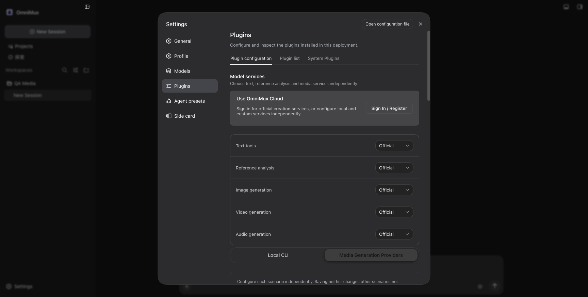
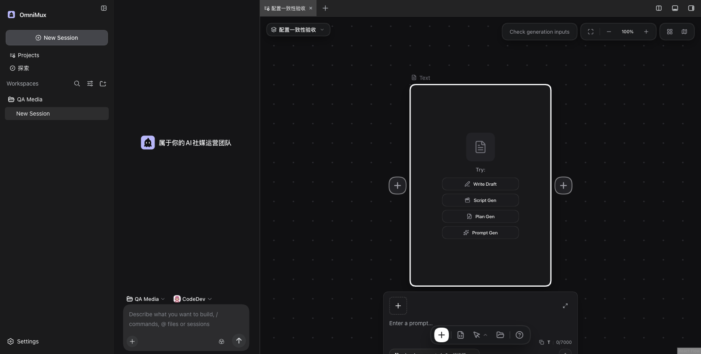

# #3312 模型设置一致性真实验收

隔离任务工作树，基线 `c5c53dcc103c6088ac925aa048202dce2294f453` 加本任务修复。正式安装本树中枢与工作流产物到自建临时 `web` 配置层，并安装已存在的侧栏插件；保留必需官方基础层，不读取或复制个人、开发版或正式版配置。浏览器访问动态本地端口，未发送真实模型请求。

## 设置保存与检查

真实 Settings → Plugins → 模型服务页面填入合成地址、合成非秘密凭据与未知图片模型。配置格式检查前后的公开配置完全相同；检查通过仅表示格式，不表示连接或生成验证。随后实际点击保存，读回确认目标专属引用与图片模型，`verified:false`，未替换文字或视频用途。编辑未提交草稿后在两个页签间切换，草稿仍在；刷新页面只恢复实际已保存字段。

本次证据目录 `.workbuddy/evidence/model-config-settings-final/` 的 assertions 五项均真：检查不持久化、保存状态诚实、页签保草稿、刷新恢复已保存型号、没有真实生成请求。Host 公开存储返回目标专属凭据来源，不记录任何密钥字节。浏览器和临时运行时清理均确认完成。

## 默认设置到新节点

实际默认模型下拉选 Claude Sonnet 4.6，创建合成私有项目，经真实项目卡片打开创作页，并从新增节点菜单创建文字节点。页面显示 `claude-sonnet-4-6`；等真实自动保存完成，公开工作区文档 version=1，唯一新节点 `params.model=claude-sonnet-4-6`、`operation=chat`。没有通过生成请求证明型号支持，也没有改会话聊天模型。

该次 `.workbuddy/evidence/model-config-sonnet-default-node/` 保留正式安装各产物的字节身份、设置截图、节点截图、公开保存文档与清理回执。之前等待把英文大小写标签误当型号导致超时、以及首次读回尚未自动保存的空文档，均保留为失败尝试；最终按真实型号和持久文档完成验收。

## 自动回归与限制

正式离线回归走公开中枢与工作流接缝，覆盖线路、用途选择、保存版本与凭据轮换、未知型号保留和既有节点/连线保护。新增真实 React 浏览器回归使用实际共享控件，未知请求与设置写尝试均独立计数。它不替代上述真实 Host 设置页面和创作页证据。

未验证真实服务连接、供应商原生适配、在线输出或费用。开发版45120验收归人工；本专项没有访问或重启共享开发实例，也不写正式版。最终全部源码独立审查、完整包与合并队列结果另列，不以局部证据称整体验收全部完成。
