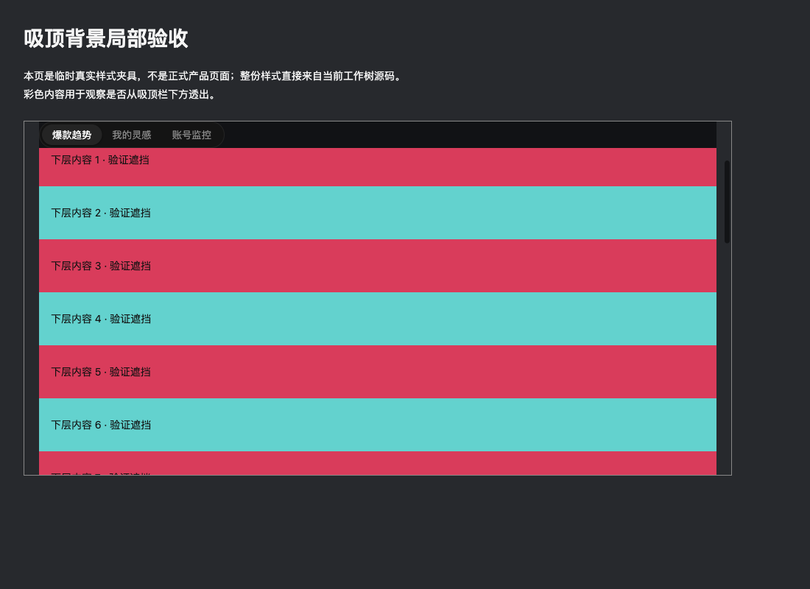

# #3328 吸顶背景回退验收

基线 `bbd56d7c7f1ba7de2e9f28b4e3c903ae101ba114`。仅恢复灵感页既有吸顶背景的末级默认色；主题变量优先级不变。准据为 [一级页布局合同](../contracts/first-level-page-layout.md)，没有新增规则或修改原测试。

真实浏览器在任务工作树内载入当前样式导出的完整 CSS，非产品登录页面。两个主题变量均缺时计算背景为 `rgb(17,18,21)`，后级变量为 `rgb(48,52,59)`，前级覆盖为 `rgb(244,243,241)`。滚动后吸顶栏顶部等于容器顶部，层级20；默认及前级主题截图像素 alpha255，下面红色内容未透出。后级主题截图红通道与计算值差1，未视为逐通道精确匹配。

同次验证样式文件 SHA256 `f86f5970a32d6e6ec2a7aa159e16f27f462bc0a7997ae713ab2e09ac4cff4e82`，浏览器载入全文相同。浏览器任务141已关闭。截图来自该次专项样式夹具，不冒充完整正式应用验收。

原滚动合同6项、已有防遮掩3项、产品基线及登记页声明检查通过；新增持久浏览器回归验证计算颜色、主题覆盖和吸顶位置。全量页面检查在隔离依赖准备前失败；灵感页目标装配合同通过。额外全仓界面扫描9处存量违规与基线逐字相同，未改这些文件或降低标准，不将其宣称通过。
